 

 

 

### ◈ MAIN MENU ◈

[▶ NEW GAME](https://portofolio-dafz-seven.vercel.app/) &nbsp;│&nbsp;
[📜 QUEST LOG](#-quest-log) &nbsp;│&nbsp;
[🎒 INVENTORY](#-inventory) &nbsp;│&nbsp;
[📊 PLAYER STATS](#-player-stats)

 

 

**PLAYER 01 — DAFZ**

*Creative Frontend Developer | UI Enthusiast | Digital Explorer*

> "Great interfaces aren't just seen. They're experienced."

 

## 🧑‍🚀 PLAYER PROFILE

Hello! I'm **Dafa**, also known as **DAFZ**.

I'm a developer who enjoys transforming ideas into interactive digital experiences. I focus on building modern, responsive, and visually engaging web interfaces while exploring animations, creative interactions, and frontend technologies.

My current interests include:

- 🎨 Creative UI/UX and modern web interfaces
- ⚡ Frontend development and interactive experiences
- 🎞️ Motion design and smooth animations
- 🌐 Building meaningful digital products
- 🚀 Exploring new technologies and creative ideas

---

## 🎒 INVENTORY — TECH ARSENAL

### ⚔️ Development Weapons

### 🔮 Tools & Utilities

### Equipment Information

| ITEM | CATEGORY | DESCRIPTION |
|:---|:---:|:---|
| React / Next.js | ⚔️ Weapon | Building modern and modular interfaces |
| Vue.js | ⚔️ Weapon | Developing reactive web applications |
| TypeScript | 🛡️ Defense | Writing structured and maintainable code |
| Tailwind CSS | 🎨 Armor | Creating responsive and consistent UI |
| GSAP / Motion | 🔮 Magic | Bringing interfaces to life with animation |
| Lenis | 🧭 Accessory | Creating smooth scrolling experiences |
| Git / GitHub | 🧰 Utility | Managing projects and collaboration |

---

## 📜 QUEST LOG — FEATURED PROJECTS

*Every project is another quest. Every challenge is an opportunity to level up.*

<b>🌱 QUEST 01 — ECOQUEST</b> &nbsp;·&nbsp; ★★★★☆

 

**TYPE:** Environmental Gamification Platform

**DESCRIPTION:**

A gamified environmental platform designed to encourage sustainable habits through daily missions, challenges, experience points, and community participation.

**FEATURES:**
- Environmental missions and challenges
- XP, levels, and streak progression
- Eco-action tracking
- Environmental impact monitoring

**TECH STACK:**

`Vue.js` `JavaScript` `Tailwind CSS`

[▶ START QUEST](https://YOUR_ECOQUEST_URL)

<b>⚡ QUEST 02 — NEXORA</b> &nbsp;·&nbsp; ★★★★☆

 

**TYPE:** Electronics E-Commerce Platform

**DESCRIPTION:**

A modern electronics shopping experience focused on intuitive navigation, product discovery, and a seamless purchasing journey.

**FEATURES:**
- Product catalog and categories
- Product search and exploration
- Shopping cart
- Checkout and payment interface

**TECH STACK:**

`Next.js` `TypeScript` `Tailwind CSS`

[▶ START QUEST](https://YOUR_NEXORA_URL)

<b>🌏 QUEST 03 — NUSANTARA EXPLORE TOUR</b> &nbsp;·&nbsp; ★★★☆☆

 

**TYPE:** Tourism & Travel Website

**DESCRIPTION:**

A travel-oriented website concept designed to introduce visitors to Indonesian destinations and provide an engaging way to explore travel experiences.

**TECH STACK:**

`Frontend Development`

[▶ START QUEST](https://YOUR_NUSANTARA_URL)

<b>👑 FINAL BOSS — PERSONAL PORTFOLIO</b> &nbsp;·&nbsp; ★★★★★

 

**TYPE:** Interactive Developer Portfolio

**DESCRIPTION:**

An experimental portfolio inspired by cinematic game interfaces, featuring immersive transitions, interactive storytelling, motion design, and a distinctive visual identity.

**FEATURES:**
- Interactive user experience
- Cinematic page transitions
- Smooth scrolling animations
- Motion-driven storytelling
- Responsive interface

**TECH STACK:**

`Next.js` `TypeScript` `Tailwind CSS` `GSAP` `Lenis`

[⚔️ CHALLENGE THE BOSS](https://portofolio-dafz-seven.vercel.app/)

---

## 🏆 ACHIEVEMENT UNLOCKED

*Milestones collected throughout the development journey.*

<b>🏅 VIEW ACHIEVEMENTS</b>

 

| ACHIEVEMENT | DESCRIPTION |
|:---|:---|
| 🥇 First Commit | Started the coding journey |
| 🎨 Pixel Perfectionist | Paying attention to UI details |
| 🎞️ Motion Master | Exploring creative animations |
| 🌱 Eco Warrior | Building environmentally conscious products |
| ⚡ Digital Creator | Turning ideas into digital experiences |
| 🔓 Secret Unlocked | You discovered this hidden achievement! |

 

**BONUS REWARD:** Explore my [Personal Portfolio](https://portofolio-dafz-seven.vercel.app/) to unlock another experience.

---

## 🐍 CONTRIBUTION SNAKE

*Watch the snake explore my coding activity.*

<picture>
  <source media="(prefers-color-scheme: dark)" srcset="https://raw.githubusercontent.com/dafzX/dafzX/output/github-snake-dark.svg" />
  <source media="(prefers-color-scheme: light)" srcset="https://raw.githubusercontent.com/dafzX/dafzX/output/github-snake.svg" />
  
</picture>

## 📊 PLAYER STATS

### GITHUB ACTIVITY

 

 

## 💬 MULTIPLAYER MODE

**Have an interesting idea? Let's build something together.**

 

### GAME OVER? NEVER.

**▶ INSERT COIN TO CONTINUE**

THANK YOU FOR VISITING MY DIGITAL WORLD.

